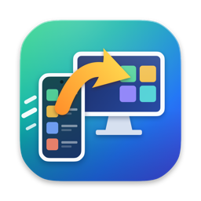
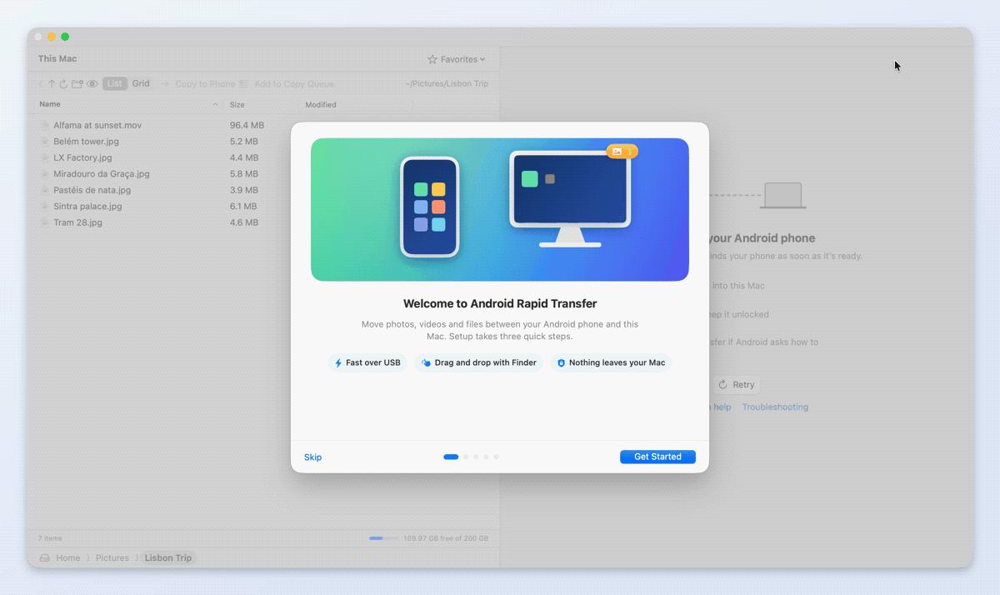
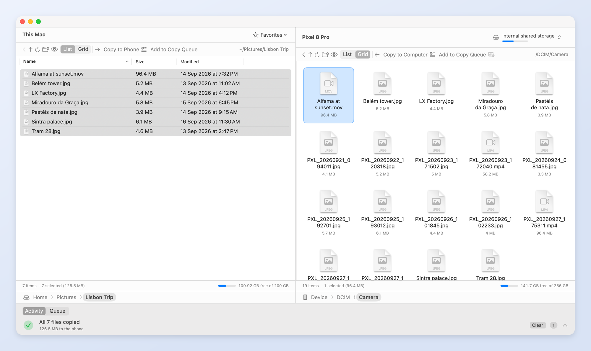
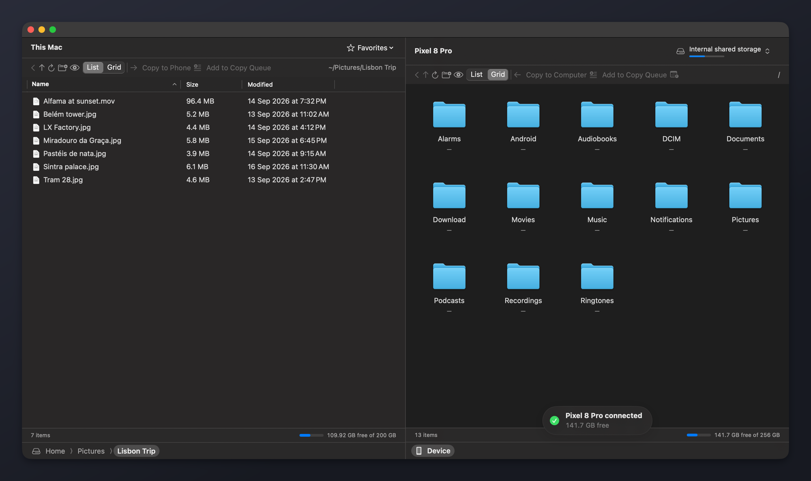
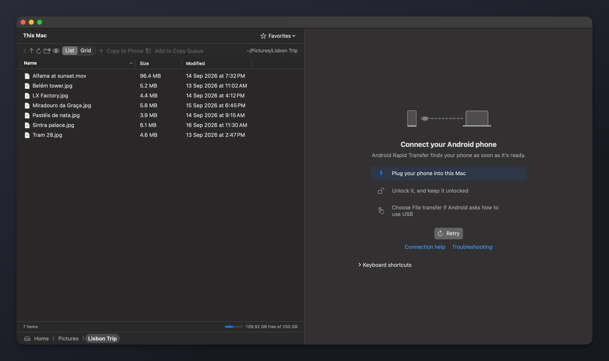
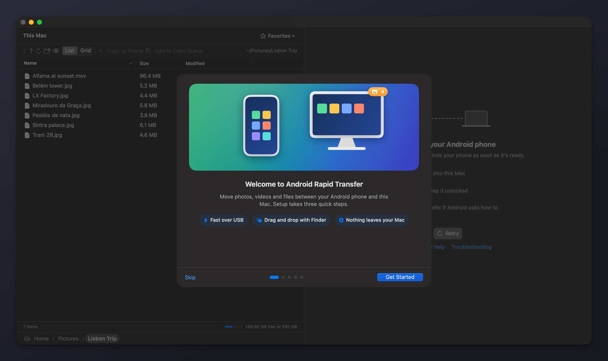

<p align="center">
  
</p>

<h1 align="center">Android Rapid Transfer</h1>

<p align="center">
  <strong>Plug in your Android™ phone. Drag your files. Done.</strong><br>
  A fast, native, open-source Mac app for moving photos, videos and files between an Android phone and your Mac over USB.
</p>

<p align="center">
  <a href="https://github.com/sameh0/android-rapid-transfer/actions/workflows/ci.yml"></a>
  <a href="https://github.com/sameh0/android-rapid-transfer/releases"></a>
  
  <a href="LICENSE"></a>
  
</p>

<p align="center">
  <a href="https://github.com/sameh0/android-rapid-transfer/releases"><strong>Download</strong></a> ·
  <a href="#features">Features</a> ·
  <a href="#speed">Speed</a> ·
  <a href="#faq-and-troubleshooting">FAQ</a> ·
  <a href="#build-from-source">Build from source</a>
</p>

<p align="center">
  
  <br>
  <sub>42 seconds, first launch to finished copies · <a href="docs/media/demo.mp4">watch the MP4</a> · recorded with the app's built-in demo phone</sub>
</p>

## Why

Macs have never been good at talking to Android phones. The file-transfer tool
Google used to offer for the Mac has been discontinued, and what is left tends to be
slow, dependent on extra drivers, or buried in a cloud-sync app you never wanted.

**Android Rapid Transfer** is the app that job deserves: a native SwiftUI app with
its own MTP engine written in Swift. There are no drivers or kernel extensions to
install, no accounts, and no cloud. Your files go straight from the phone to the
Mac and back over the cable, and the whole thing is open source under the MIT
License.

## Features

<p align="center">
  
</p>

- **Your phone, next to your Mac.** Browse the phone in a fast list or grid, with
  your Mac's folders alongside it in the same window. Folders slide in as you open
  them; breadcrumbs, back and up work the way Finder does.
- **Copy either way in one click.** Select files and click **Copy to Phone** or
  **Copy to Computer**, drag them to and from Finder, or collect files from
  several folders with **Copy to Queue** and paste them where they belong.
- **Live progress you can trust.** Every copy shows files done, bytes, speed and
  time left, puts overall progress in the Dock, and ends with a small
  celebration. It keeps running in the background and posts a notification when
  it finishes while you're in another app.
- **Stop means stop.** Stop takes effect straight away, even in the middle of a
  large file, and leaves no half-written files on either side. Interrupted
  copies can be resumed; name clashes can be replaced, skipped or kept side by
  side.
- **Copy by date range.** Pick a range and copy just the photos and videos from
  it, with a live preview while the phone is scanned.
- **Knows when you plug in.** The phone is picked up as soon as it's connected,
  with a connection screen that walks you through unlocking it and choosing File
  transfer, and a friendly note when something needs your attention.
- **Every storage.** Switch between internal storage and an SD card, with free
  space shown for each.
- **At home on macOS.** Light and dark appearance, full keyboard operation,
  VoiceOver labels and announcements throughout, and every animation honours
  Reduce Motion and goes quiet when the window is idle or hidden.
- **Help built in.** A short setup guide on first launch, troubleshooting for
  the common connection problems, and an opt-in diagnostic bug report.
- **Updates itself** from GitHub Releases, with an optional beta channel.

<table>
  <tr>
    <td width="50%"></td>
    <td width="50%"></td>
  </tr>
  <tr>
    <td align="center"><sub>Connected, in dark mode</sub></td>
    <td align="center"><sub>The connection screen tells you what to do next</sub></td>
  </tr>
  <tr>
    <td colspan="2"></td>
  </tr>
  <tr>
    <td colspan="2" align="center"><sub>A three-step guide on first launch</sub></td>
  </tr>
</table>

## Speed

The MTP engine is built for throughput: large transfers are streamed in big USB
reads and writes, folder listings are fetched in bulk, and the interface only
draws what is on screen. Measured on one phone, a **Xiaomi REDMI Note 15 5G**
connected to an Apple silicon Mac over USB:

| What | Result |
|---|---|
| Copy a 200 MB file to the phone | **~38 MB/s** |
| Copy a 200 MB file to the Mac | **~42 MB/s** |
| Copy a folder of 50 files to the phone | **1.9 s** |
| Scan the whole phone (208 folders, 2,052 files) | **2.2 s** |
| Show a folder of 2,000 items (list or grid) | **~0.05 s** to lay out and draw |

These are single-device measurements, not a benchmark suite. Your numbers will
depend on the phone, its USB controller, the cable and the port. Many phones
only support USB 2.0 speeds, whatever the cable. The demo at the top of this page
uses the app's built-in demo phone, whose copies run at about the measured speeds.

## Install

1. Download the latest `Android-Rapid-Transfer-<version>.dmg` from
   [GitHub Releases](https://github.com/sameh0/android-rapid-transfer/releases).
2. Open it and drag **Android Rapid Transfer** to **Applications**.
3. Open the app. On first launch it walks you through connecting your phone.

If macOS says the app can't be checked for malicious software, Control-click (or
right-click) it in Applications, choose **Open**, and confirm. Builds that aren't
yet notarized need this once; see
[DISTRIBUTION.md](native/AndroidRapidTransfer/DISTRIBUTION.md#what-ad-hoc-signing-means-for-recipients)
for details.

**Homebrew** *(coming soon)*: `brew install --cask android-rapid-transfer`.

**Requirements:** macOS 14 Sonoma or later on Apple silicon or Intel, an Android
phone (or another MTP device), and a USB cable that carries data. Some cables only
charge.

## Connect your phone

1. **Unlock the phone** and keep it unlocked while it connects.
2. **Plug it into the Mac** with a USB cable that carries data.
3. On the phone, open the **Charging this device via USB** notification and choose
   **File transfer**.
4. If the phone asks **Allow access to phone data?**, tap **Allow**.

The phone's storage appears in the window a moment later.

## FAQ and troubleshooting

The app has all of this, and more, under **Help › Troubleshooting & FAQ**.

<details>
<summary><strong>My phone isn't detected</strong></summary>

- Try another cable: many cables only charge. Plug straight into the Mac rather
  than an unpowered hub.
- Unlock the phone and keep it unlocked while it connects.
- Unplug, wait a few seconds, plug back in, then click **Retry**.
- Quit other apps that may have grabbed the phone first (see below).
</details>

<details>
<summary><strong>It says File transfer, but nothing shows up</strong></summary>

Android sometimes keeps showing File transfer after the connection has actually
stopped. On the phone, open the USB notification, choose **Charging only**, wait a
few seconds, choose **File transfer** again, then click **Retry**. If that doesn't
help, restart the phone.
</details>

<details>
<summary><strong>The phone is locked, or went to sleep</strong></summary>

A locked phone keeps its files hidden, and many phones drop out of File transfer
when they lock. Unlock it; if the storage stays empty, click **Refresh**. For long
copies, set the phone's screen timeout a little longer.
</details>

<details>
<summary><strong>Samsung (and others) keep asking "Allow access to phone data?"</strong></summary>

Android asks every time a computer connects in File transfer mode, and until you
tap **Allow** the app can see the phone but not its files, so storage looks empty.
Unlock the phone before plugging in and tap **Allow** rather than dismissing the
prompt. If the prompt reappears every few seconds, another app on the Mac is
connecting and disconnecting. Quit it (see below), then switch the USB mode to
Charging only and back to File transfer.
</details>

<details>
<summary><strong>Another app has the phone</strong></summary>

MTP lets only one app use a phone at a time. Quit these before connecting:
Google's discontinued Mac file-transfer app (it opens itself whenever a phone
connects, so remove it from Login Items too), Google Drive, Dropbox or OneDrive
camera upload, Samsung Smart Switch, and Image Capture, Preview or Photos if macOS
opened them for the phone.
</details>

<details>
<summary><strong>What about big videos?</strong></summary>

Copies stream in chunks with live progress, can be stopped at any point without
leaving partial files behind, and interrupted copies can be resumed from
**File › Resume Copies…**. Single files larger than 4 GB haven't been tested on a
real phone yet; if you try one, please report how it went.
</details>

## Privacy

Android Rapid Transfer has no analytics, no accounts and no telemetry. Your files
move only between the Mac and the phone, over the cable.

The one thing that reaches the network on its own is the update check: the app
uses [Sparkle](https://sparkle-project.org) to read an update feed published with
the project's GitHub Releases. You can turn automatic checks off in **Settings ›
General**. A bug report is only created when you ask for one (**Help › Report a
Bug…**); it is saved to your Desktop, lists what it contains first, and is never
uploaded for you. The full statement is in the app under **Help › Privacy**.

## Build from source

You need Xcode 16 or later. If `xcode-select -p` points at the Command Line Tools
rather than Xcode, SwiftUI's macros won't expand and the build fails on the first
`@State`, so point the tools at Xcode for these commands:

```shell
export DEVELOPER_DIR=/Applications/Xcode.app/Contents/Developer

cd native/AndroidRapidTransfer
swift build
swift test
swift run AndroidRapidTransfer          # against a connected phone
swift run AndroidRapidTransfer --mock   # against a built-in mock phone

cd ../MTPKit && swift test

cd ../AndroidRapidTransfer
./make-app.sh                           # dist/Android Rapid Transfer.app
```

A first build takes a few minutes. The app icon is drawn in code
(`AppIconArtwork`); after changing it, run `Scripts/make-app-icon.sh` to regenerate
`Resources/AppIcon.icns`. Signing, notarization, disk images and publishing
updates are covered in
[DISTRIBUTION.md](native/AndroidRapidTransfer/DISTRIBUTION.md), as is CI:
`Scripts/ci-build.sh test` and `Scripts/ci-build.sh package` run exactly what
GitHub Actions runs, the latter producing the universal DMG in `ci-artifacts/`.

Debug builds also accept `--demo`: the demo phone used for the video above. It
starts unplugged, **Demo › Plug In Demo Phone** (⌃⌥⌘P) connects it, and copies run
at about the measured speeds. Run it with `HOME` and `CFFIXED_USER_HOME` pointing at a
scratch folder so it can write its placeholder downloads there.

## How it works

```
AndroidRapidTransfer         SwiftUI app: windows, panes, transfer panel, onboarding
└─ AndroidRapidTransferCore  view models, connection controller, transfer queue, settings
   └─ MTPKit                 MTPDeviceProvider protocol, models, errors, mock provider
      ├─ SwiftMTP            pure-Swift MTP/PTP engine over IOUSBHost
      └─ USBWatcher          USB hotplug detection (IOKit)
```

- **SwiftMTP** speaks MTP directly to the phone's USB interface through Apple's
  IOUSBHost framework: no libusb, no drivers, no helper processes. A release
  bundle contains only the app, Apple's frameworks and Sparkle.
- **AndroidRapidTransferCore** owns the connection lifecycle (hotplug, automatic
  reconnects, release on quit) and a serial transfer queue that reports progress,
  handles conflicts and supports stop, resume and retry.
- **The app** is SwiftUI with a small AppKit bridge where AppKit does it better
  (the native table, drag sessions), and a shared motion vocabulary that honours
  Reduce Motion.

| Path | What |
|---|---|
| `native/AndroidRapidTransfer` | the app, its core library, tests, packaging scripts, the icon generator, and device probes |
| `native/MTPKit` | the MTP layer: `MTPKit`, `SwiftMTP` and `USBWatcher` |
| `docs/media` | the demo video and screenshots on this page |

## Contributing

Bug reports, device reports and pull requests are welcome.

- **Found a bug?** Use **Help › Report a Bug…** in the app. It collects diagnostics
  into a zip on your Desktop and opens a new
  [GitHub issue](https://github.com/sameh0/android-rapid-transfer/issues) for you
  to attach it to.
- **Tried it with your phone?** An issue saying which phone, what worked and how
  fast it was helps a lot: the app has been measured on only a few devices so far.
- **Sending a change?** Keep `swift build` and `swift test` green in both packages,
  and try it against `--mock` (and a real phone, if the change touches the USB or
  transfer path).

## License

MIT © Sameh. See [LICENSE](LICENSE). The app uses
[Sparkle](https://sparkle-project.org) for updates; its notices ship in the app
under **Help › Acknowledgements**.

Android is a trademark of Google LLC. Mac and macOS are trademarks of Apple Inc.
This project is not affiliated with or endorsed by Google or Apple.
